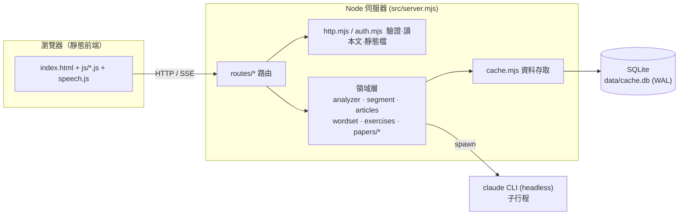
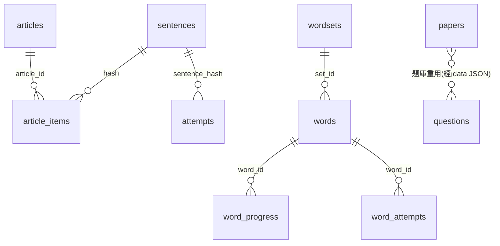
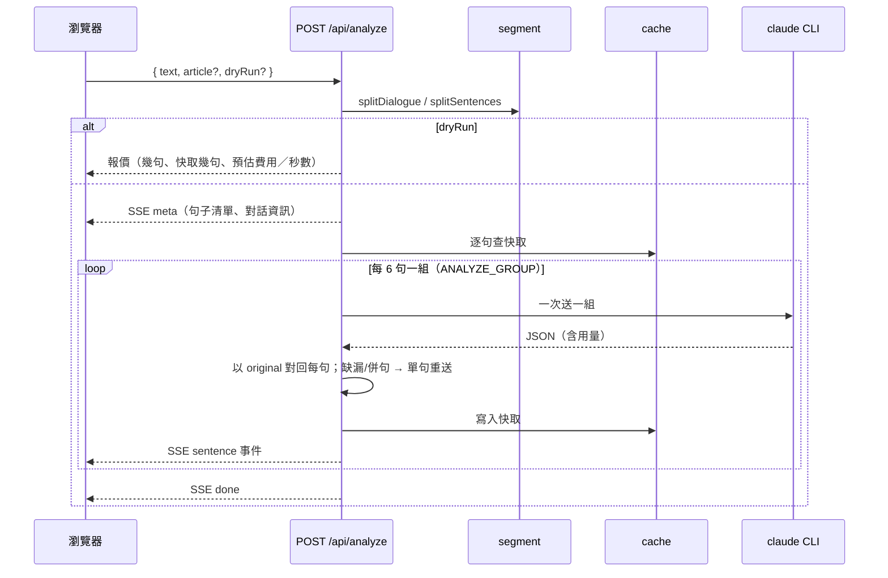

# 英文句型解剖（saving_peater）軟體設計文件（SDD）

| 項目 | 內容 |
|---|---|
| 文件版本 | 1.0 |
| 對應程式 | `main` 分支 commit `3143efa` 之後（含測驗卷多份並存、單字同義字情境題） |
| 撰寫日期 | 2026-10-11 |
| 讀者 | 維護者、日後接手的開發者 |
| 範圍 | 整個系統：分析、單字表、文章表、句子練習、測驗卷、弱點統計、登入與維運 |

> 本文依目前程式碼重新整理而成。與 README 重疊的使用說明不在此重複，這裡著重「為什麼這樣設計」「各部分怎麼接在一起」「有什麼限制」。

---

## 1. 簡介

### 1.1 目的

「英文句型解剖」讓國中程度的學習者（與家教／家長）把英文句子、課文、單字交給系統，得到：

1. **逐句文法分析**：五大句型、逐字詞性、16 種時態、動詞三態、常見錯誤、語序、繁體中文翻譯。
2. **以分析結果反向產生的練習**：單字測驗、句子練習、測驗卷（試卷）。
3. **學習追蹤**：間隔複習（Leitner）與弱點統計。

### 1.2 設計目標與取捨

| 目標 | 具體做法 | 取捨 |
|---|---|---|
| 零依賴、易部署 | 只用 Node 內建 `node:http`、`node:sqlite`；前端純靜態檔、無建置步驟 | 要 Node ≥ 22.14；沒有框架提供的便利 |
| 不另付 API 費用 | 模型呼叫走本機 `claude` CLI（headless），用使用者訂閱登入 | 每次呼叫要重讀系統提示（約 34K tokens），因此全面採「批次＋快取」降低成本 |
| 出題不花錢 | 練習與測驗卷題目由程式從分析結果反向產生；只有少數題型（閱讀、克漏字語意干擾、情境應答、延伸題）才呼叫模型 | 程式出題變化度有限，所以保留「偏好模型」選項 |
| 結果可信 | 模型輸出一律經程式驗證／校正（代名詞格位、原句比對、題目驗證）；對不上就重送或略過 | 偶爾多花一次呼叫 |
| 花費透明 | 凡會呼叫模型的操作先「報價」（dry run），使用者確認才執行；每次呼叫記錄用量 | 多一步確認 |
| 區網安全 | 預設只聽 127.0.0.1；對外必須設帳密 | 單一帳號，無帳號管理 |

### 1.3 名詞

| 名詞 | 意思 |
|---|---|
| 分析結果（analysis） | 模型對單一句子輸出的 JSON，快取在 `sentences` 表，全系統共用 |
| 單字表／文章表 | 使用者建立的範圍；文章表只存「句子順序」，分析結果仍在 `sentences` |
| 測驗卷（paper） | 一份由多種題型組成、滿分 100 的卷子 |
| 題庫（bank） | 模型出過的題存進 `questions` 表，之後優先重用 |
| 延伸題 | 出自使用者範圍之外（字族、易混淆字、同篇相關內容）的題，用來提高難度 |
| 報價／確認 | 呼叫模型前先算預估費用與次數，使用者按下確認才送出 |
| Leitner | 盒子制間隔複習：答對升盒、答錯回第一盒 |

---

## 2. 系統總覽

### 2.1 邏輯架構



- **單一行程、單一資料庫檔**；沒有訊息佇列、沒有外部服務。
- **模型是外部子行程**：每次呼叫 `spawn claude -p …`，以 `--system-prompt-file` 載入提示、`--output-format json` 取回結果與用量；`--allowedTools ''`（分析）或 `Read`（讀圖）限制工具。
- **前端無狀態重度**：使用者代碼與少量偏好放 `localStorage`；所有學習資料在伺服器的 SQLite。

### 2.2 功能分頁

| 分頁 | 功能 | 是否可能花模型額度 |
|---|---|---|
| 分析 → 即時分析 | 貼文字／拍照 → 斷句 → 逐句分析 → 卡片顯示；可存成文章表 | 是（先報價） |
| 分析 → 文章表 | 檢視文章、展開分析、標出單字表涵蓋、改名、刪除 | 否 |
| 單字 → 單字清單／單字測驗 | 建立字表（貼上／拍照）、五種＋三態模式測驗、批次分析例句 | 建字表、分析例句時是；測驗否 |
| 句子練習 | 從分析過的句子反向出題（句型、時態、詞性、三態、改錯、代名詞） | 否 |
| 測驗卷 | 出卷（範圍、題數、難度、題型）→ 作答 → 交卷 → 訂正／自評／AI 批改 → 歷史 | 視難度與題型（先報價） |
| 弱點 | 各維度正確率；出題時依弱點加權 | 否 |
| 歷史 | 近期請求紀錄與用量 | 否 |

### 2.3 技術堆疊

| 層 | 技術 |
|---|---|
| 執行環境 | Node 24（需 ≥ 22.14），ES modules，無第三方套件 |
| 儲存 | `node:sqlite`（WAL），`PRAGMA user_version` 做遷移，`VACUUM INTO` 備份 |
| 通訊 | JSON over HTTP；分析結果用 SSE 串流 |
| 模型 | Claude Code CLI；分析預設 `opus`（`ANALYZER_MODEL`），測驗卷出題預設 `sonnet`（`EXAM_MODEL`） |
| 前端 | 手寫 HTML/CSS/JS（classic script，全域函式），Web Speech API 朗讀 |
| 測試 | Node 腳本＋假的 Claude CLI＋CDP 驅動的無頭 Chrome |
| 部署 | Windows 工作排程器執行 `start.ps1`（環境變數在專案外） |

---

## 3. 專案結構

```
saving_peater/
├─ src/
│  ├─ server.mjs          進入點：路由表、定期清理、啟動訊息
│  ├─ config.mjs          環境變數 → 常數
│  ├─ context.mjs         開啟資料庫（含種子快取）
│  ├─ http.mjs            readBody / sendJson / pool / authed / decodeImage / serveStatic
│  ├─ auth.mjs            帳密登入、session、鎖定
│  ├─ analyzer.mjs        呼叫模型分析、重試、JSON 解析、代名詞格位校正
│  ├─ segment.mjs         斷句、對話拆分
│  ├─ articles.mjs        文章 → 段落 → 句子
│  ├─ wordset.mjs         單字表整理、單字題型、批改、讀圖
│  ├─ exercises.mjs       句子練習出題（程式）
│  ├─ cache.mjs           全部 SQL（句子、字表、作答、文章、卷子、session…）
│  ├─ migrate.mjs / migrations.mjs   版本化遷移（v1~v4）
│  ├─ claude-bin.mjs      找 claude 執行檔、spawn
│  ├─ cache-cli.mjs       種子快取匯入／清理的命令列
│  ├─ routes/             analyze · practice · words · articles · papers · auth · shared
│  └─ papers/             測驗卷：plan · pool · gen · model · validate · grade · aigrade · paper
├─ prompts/               analyzer-system · analyze-ocr · wordset-system · wordset-ocr · exam-gen · exam-grade
├─ prototype/             前端：index.html · app.css · speech.js · js/*.js
├─ test/                  api/ · browser/ · 單元測試 · fake-claude.mjs
├─ eval/                  黃金測試集與評估腳本（分析品質）
├─ fixtures/seed-cache.jsonl   種子快取
├─ docs/SDD.md            本文
└─ README.md · MIGRATION.md
```

規模（約）：後端 4,800 行、前端 JS 3,200 行、CSS 770 行、提示詞 1,000 行。

---

## 4. 資料設計

資料庫：`data/cache.db`（可由 `DB_FILE` 覆寫）。遷移引擎 `migrate.mjs` 依 `PRAGMA user_version` 套用 `migrations.mjs` 清單，**每版在交易內執行、套用前自動備份、只增不改**。



### 4.1 資料表

| 表 | 版本 | 內容與用途 | 保留策略 |
|---|---|---|---|
| `sentences` | v1 | 單句分析結果 JSON（`hash`=正規化原句雜湊）；攤平欄位 `pattern_id / tense_* / in_scope / issue`；對話欄位 `speaker / context`；用量欄位 | 永久；`prune` 不清掉文章表用到的句子 |
| `attempts` | v1 | 句子練習作答（`qtype`、句型、時態、詞性、格位、對錯、`is_fix`） | 永久 |
| `wordsets` / `words` | v1 | 字表與單字；`words.data` 是 senses／confusable／family 的完整 JSON；`UNIQUE(set_id, term)` | 永久，刪字表連帶刪作答 |
| `word_attempts` / `word_progress` | v1 | 單字作答與 Leitner 盒子（`box`、`due_at`、`correct`、`total`） | 永久 |
| `requests` | v1 | 每次呼叫的紀錄：`kind`（analyze／wordset／ocr／ocr-text／paper-gen／paper-grade）、字數、句數、命中、花費、token、原文 `text` | 原文 `HISTORY_DAYS`（30）天後清除，統計列保留 |
| `quizzes` | v1 | 已出但未交卷的練習題（含答案，伺服端保存） | 7 天 |
| `articles` / `article_items` | v2 | 文章表只存 `(idx, para, hash)`；`para` 對話時是「第幾次發言」 | 永久 |
| `papers` | v3 | 卷子：設定、題目（含答案）、作答、結果、狀態 `open/submitted`、分數 | `PAPER_DAYS`（30）天或最近 `PAPER_KEEP`（20）份，先到者為準 |
| `questions` | v3 | 題庫：模型出的題 `type / src / ref / anchors / payload / used / wrong` | 上限 `QUESTION_MAX`（500）淘汰 |
| `sessions` | v4 | 登入 session：**只存 cookie 的 SHA-256**、到期時間 | 過期自動清 |

### 4.2 設計決策

1. **分析以「單句」為快取單位**。文章表、單字例句、練習、測驗卷全部指向同一份 `sentences`，同一句只付一次錢。
2. **答案不隨題目下發**。題目含答案存伺服器（`quizzes`／`papers.data`），前端拿到的是去除 `answer / alsoAccept / accept / explain` 的版本，交卷才批改。
3. **同字多表共用進度**：同一單字出現在多份字表時，作答同步寫到所有重複列；合併顯示取「練得最多的一筆」而非相加，避免重複計數。
4. **訂正不計統計**：`is_fix=1` 的作答要留紀錄，但不計入弱點與 Leitner。
5. **歷史是快取、題庫是資產**：卷子到期清除；模型出的題（花過錢）另存題庫，只設數量上限。

### 4.3 分析結果 Schema（核心）

每句一個物件（節錄，完整定義與範例在 `prompts/analyzer-system.md`「輸出 Schema」）：

```jsonc
{ "index": 0, "original": "…", "translation": "…",
  "clauses": [{ "role":"main|subordinate", "connector":null,
    "pattern":{"id":1-5,"label":"S + V + O","name":"句型三"},
    "constituents":[{"text":"…","role":"S|V|O|C|IO|DO|M-manner|M-place|M-time|M-freq|M-other"}],
    "tense":{"time":"present|past|future|past-future","aspect":"simple|progressive|perfect|perfect-progressive",
             "label":"…","formula":"…","evidence":["…"],"inScope":true},
    "verb":{"lemma":"…","form":"…","irregular":false,"forms":{"base":"…","past":"…","pastParticiple":"…","ing":"…","third":"…"}} }],
  "words":[{"text":"…","pos":"n|pron|v|aux|adj|adv|prep|conj|art|num|to|interj","case":"（僅 pron）"}],
  "wordOrder":{"主":…,"動":…,"賓":…,"方":…,"地":…,"時":…},
  "notes":[{"type":"tip|error","errorCode":…,"span":…,"message":…,"correction":…}],
  "inScope":true, "issue":null }
```

`issue` 非空表示無法正常分析（`fragment` 片語、非英文、無意義…）；填空題（含 `_____`）`issue` 保持 `null`。

---

## 5. 功能設計

### 5.1 句子分析（`routes/analyze.mjs`、`analyzer.mjs`、`segment.mjs`）



要點：

- **斷句**：換行也是句子邊界；縮寫表（`Mr. Dr. No. Sat.` …）區分真縮寫與句尾，`No.`／`Sat.` 等「同時是常用字」的詞只有後接數字才當縮寫。
- **對話**：每行 `Name: …` 且至少兩位說話者才視為對話（排除 `Note:` `Answer:` 等）。說話者標記不進句子；**一人一段發言再拆成一句一句各自分析**，並記下 `speaker`、`turn`（`context` 為前一句對方的話）。
- **批次**：快取未命中的句子每 `ANALYZE_GROUP`（預設 6）句併一次呼叫，省去重複讀系統提示（實測六句 $0.099 vs 逐句 $0.164）。模型回來的 `original` 必須與送出的對得上，否則該句退回單句；整批失敗也退回單句；額度用盡立即停止（`halted`）。
- **單句防呆**：`analyze()` 遇到非 JSON、`original` 為空，同一句自動再問一次（把句子包進「Analyze this sentence and reply with JSON only: …」），兩次花費都計入。若模型把一句拆成多句，標 `split` 失敗並說明，不悄悄丟內容。
- **代名詞格位由程式決定**：`mine/my/me/I` 等只有一種可能的形式，程式直接判定；僅 `her/his/its/it/you` 等有歧義時採模型判斷，沒填再用「後接名詞」規則補。校正在**讀快取時**也執行，規則更新後舊資料自動補上。
- **併發與上限**：`CONCURRENCY`（6）限制同時子行程數；一般貼上上限 `MAX_CHARS` 4000／`MAX_SENTENCES` 25，文章模式 20000／120。
- **拍照辨識**（`/api/analyze-ocr`、`/api/wordset-ocr`）：圖片先在瀏覽器縮到最長邊 1600px，後端驗檔頭（JPEG／PNG／WebP／HEIC）與大小（10MB），寫成暫存檔給模型 `Read`，**用完即刪**。辨識結果填進輸入框讓使用者核對，不直接花額度分析。考卷選擇填空題會還原成完整正確的句子。

### 5.2 文章表（`articles.mjs`、`routes/articles.mjs`）

- 即時分析輸入框下的「文章名稱」：留空＝只分析不存；新名字＝建立；既有名字＝附加（重複句略過）。
- 流程：**報價 → 確認 → 分析 → 全部成功才存檔**；有失敗不存，已分析的句子都在快取，再按一次只處理缺的。
- 只存 `(idx, para, hash)`；段落＝空行分隔，**對話的段＝一次發言**。
- 離開保護：分析中輸入框蓋上提示，並在 `localStorage` 記「這篇未完成」，下次進入出現「按此繼續」（續做先報價，只處理剩下的）。
- 檢視：每句原文＋翻譯，可展開完整分析（含詳解、朗讀、單字提示便條）；選一份單字表可標出文章涵蓋的字。

### 5.3 單字表（`wordset.mjs`、`routes/words.mjs`）

- **建立**：貼上（可含中文）／拍照／拖放。每批 15 字呼叫一次模型（`wordset-system.md`），產出每個詞性的意思、例句、音節拆解、拼字提醒、易混淆字、衍生字（**不輸出音標**，學的是自然拼音）。
- **測驗題型**（程式生成，不花額度）：

| 模式 | 說明 |
|---|---|
| `zh2en` 中考英 | 看中文寫英文，提示音節骨架。**字表內另有字也有相同中文意思**（如 end／finish＝結束）時，改為「挖空例句＋中文句子」的情境題；沒有例句才兩個字都算對 |
| `en2zh` 英考中 | 看英文選中文，誘答來自同字表 |
| `listen` 聽考 | 朗讀單字，聽完拼出 |
| `cloze` 例句填空 | 變化形與原形都接受；有同義字時多給字母數 |
| `sense` 詞義辨析 | 同字不同句不同義 |
| `forms` 動詞三態 | 兩格填空，`got/gotten` 皆對 |

- **Leitner**：盒子 0~5，間隔 10 分／1 時／1 天／3 天／7 天／14 天；答對升盒、答錯回 0。出題時到期優先、沒考過次之、熟的最後。
- **批次分析例句**：字表上方一鍵，每批寫快取、可中斷續跑；分析過的例句併入句子練習題庫。
- **同義字判定**：`sharesZh`（中文意思拆段，比對是否有共同段）→ `synonymsOf`；測驗卷選擇題也用它剔除干擾選項。

### 5.4 句子練習（`exercises.mjs`、`routes/practice.mjs`）

由分析結果**反向生成**，1 毫秒、零成本、題目與解答必然與分析一致。

- 題型：句型判斷、時態填空（含線索與中文翻譯）、詞性判斷、改錯、代名詞格位、代名詞填空（只出主格≠答案者）。
- **品質過濾**：口語短句（≤2 字）、`issue` 為 `fragment`、缺主詞或動詞的句子不出句型／詞性／時態題；含空格的原句不出挖空類題。
- **弱點加權**：權重 `0.25 + (1 − 正確率) × 2.25`（全錯約 2.5 倍、全對約 0.25 倍、無資料 1 倍）。
- 批改在伺服端（大小寫、空白、句尾標點不計較），作答寫入 `attempts`。

### 5.5 測驗卷（`src/papers/*`）

#### 5.5.1 流程

```mermaid
flowchart TD
  A[選範圍: 單字表+文章表] --> B[/api/paper-preview/<br/>配題·分數·報價]
  B --> C{需要模型?}
  C -- 否 --> E
  C -- 是 --> D[使用者確認報價 confirm:true]
  D --> E[/api/papers 出卷/<br/>程式出題 + 題庫重用 + 模型補齊]
  E --> F[驗證; 缺的只補問缺的部分]
  F --> G[作答 · 自動存檔]
  G --> H[交卷 · 程式批改]
  H --> I[訂正 · 自評 · 選用 AI 批改]
```

#### 5.5.2 題型（`plan.mjs` 的 `TYPES`，共 11 種）

| 題型 | 需要 | 出題方 | 備註 |
|---|---|---|---|
| 單題選擇 `mc` | 單字或句子 | 程式 | 核心；單字題＋文法題；同義字不當干擾 |
| 閱讀測驗 `read` | 文章 | 模型 | 核心；每篇 5 題為單位 |
| 克漏字 `cloze` | 文章 | 程式＋模型（語意干擾項） | 核心；整篇一個單位 |
| 文意選填 `wbank` | 文章 | 程式 | 字庫 |
| 情境應答 `reply` | 對話文章 | 模型 | 前一句是問句、說話者換人、回答 3–25 字 |
| 句子重組 `reorder` | 句子 | 程式 | 可接受多種順序（時間修飾語句首句尾） |
| 改錯 `fix` | 句子 | 程式 | |
| 單字填空 `fill` | 單字 | 程式 | |
| 配合題 `match` | 單字 | 程式 | 每題 0.5×權重 |
| 翻譯 `trans` | 句子 | 程式（開放題） | 自評或 AI 批改 |
| 造句 `make` | 單字 | 程式（開放題） | 自評或 AI 批改 |

#### 5.5.3 配題與計分（`plan.mjs`，純函式、種子可重現）

- 題數 25–50，**滿分剛好 100**：每題分數＝100×權重÷Σ(題數×權重)，進位到 0.5，在範圍內挑「剛好加總 100」的配題。
- 自動配題：核心三塊（選擇、閱讀、克漏字）必出，其餘隨機補（25–34 題抽 3–4 種、35–50 題抽 4–5 種）；自選題型湊不滿時放寬範圍（`relax`）。
- 各題型題數範圍依 N/50 縮放並保底，且受「素材供給量」限制。
- **難度＝延伸題比例**：簡單 0、中等 30%、困難 60%。延伸題先分給能「免費延伸」的題型（字族、易混淆字作為答案；配合、造句全部可免費延伸），不足再請模型。
- **預覽與正式出卷用同一個種子**，所以畫面上的配題就是出出來的配題。

#### 5.5.4 出題引擎

1. `pool.mjs` 把範圍展開成「單字、已分析句子（去重、排除含空格句）、文章（段落→句子，保留說話者）、已知字集、免費延伸字」，不呼叫模型。
2. `gen.mjs`：每個題型的 `candidates` 函式列出做得出來的題，`sample` 抽樣（`n≤0` 回空）。
3. `model.mjs`：`planModelWork` 先算要請模型做什麼（報價用）→ `runModelWork` 實際執行；**解析錯誤重試一次**；題目存進題庫 `questions`（`read / cloze-dist / ext-* / read-ext / reply`），重用時優先取庫存。
4. `validate.mjs`：模型出的題逐題驗證（選項數、答案在選項內、文章 hash 對得上、延伸字是否真的在範圍外…）；**不合格的丟掉，只對缺的部分再問一次**，最多重規劃 5 輪。
5. 省錢模式：不呼叫模型，只用程式題與題庫現成的題；供給不足時顯示原因。

#### 5.5.5 作答、交卷、批改（`paper.mjs`、`grade.mjs`、`aigrade.mjs`）

- **自動存檔**（800ms 去抖＋`pagehide` beacon）；重新整理可續做。
- **多份並存**：伺服器不限制未交卷份數；出卷頁列出全部作答中的卷子（第幾份・難度・題數）各自繼續；作答畫面有「先放著，再出一份新卷」。每份各自設定難度（刻意不做「份數」選項）。設定剛改過、報價未重算時停用開始鍵，避免拿舊報價出卷。
- **批改**：選擇題比對、文字題 `gradeWord`、排序題接受多種順序；造句／翻譯程式只檢查可檢查的（用字、長度…），其餘標「待自評」。
- **AI 批改（選用）**：造句與翻譯可先報價再請模型批改，`validateGrades` 驗證回傳，寫入 `data.ai`（採納者進 `data.self`）。
- **訂正**：只重做答錯的題，不影響原分數與統計。
- **統計**：第一次交卷才記弱點與 Leitner；自評題不計入。
- 歷史：列表可繼續／看結果／兩段確認刪除；列印試卷與答案卷。

### 5.6 弱點統計（`routes/practice.mjs`、`js/weakness.js`）

四組維度：五大句型、必學 6 時態、詞性、題型（含測驗卷）。長條依正確率著色（紅／琥珀／綠）並同時顯示百分比與分數，不單靠顏色；作答數 <2 標「資料不足」；沒作答過的仍列出標「無資料」；超綱時態另列。

### 5.7 朗讀（`prototype/speech.js`、`js/speak.js`）

- 純瀏覽器 Web Speech API，不花額度、不需網路；`Speech` 介面固定（`ready/available/voices/speak/stop…`），可日後換成本機神經網路 TTS 而呼叫端不動。
- 語音選擇：只挑**本機**語音（雲端語音不發逐字事件）→ 平台偏好清單 → 過濾趣味語音 → 取第一個英語本機語音。
- `onWord({start,end})` 的字元座標與分析結果 `words[].start/end` 同一套，逐字亮起不需對齊。
- **結束保險**：iPhone 常不送 `end` 事件，所以在 `end` 之外加輪詢（`speaking` 變 false）與逾時，按鈕必定回到「朗讀」。

### 5.8 登入與驗證（`auth.mjs`、`http.mjs`）

- 一組帳密（`AUTH_USER/AUTH_PASS`，只放在專案外的 `start.ps1`）。登入成功發隨機 32 位元組 session 碼，放 **HttpOnly、SameSite=Lax** cookie（`sp_session`，預設 90 天）；**資料庫只存其 SHA-256**，資料庫外流也拿不到可用碼。
- 比對先各自雜湊再 `timingSafeEqual`，帳號與密碼兩個都比，不因帳號錯提早結束。
- **鎖定**：同一來源連續 5 次錯 → 鎖 5 分鐘。
- 舊的 `AUTH_TOKEN`（`x-auth-token` 或 `?token=`）仍可用，給腳本與測試。
- **公開端點只有**：`/api/health`、`/api/samples`、`/api/login`、`/api/logout`；其餘（含唯讀的歷史、統計、字表、弱點）都要驗證。沒設任何驗證時一律放行（僅適合 127.0.0.1）。
- 前端：`window.fetch` 包裝在 401 時自動顯示登入表單（或存取碼輸入框）；有登出鈕。

---

## 6. 介面設計（HTTP API）

「驗證」欄：公＝公開；驗＝需登入或存取碼（`AUTH_ON` 為真時）。

| 方法 路徑 | 驗證 | 說明 |
|---|---|---|
| GET `/api/health` | 公 | 模型、上限、`authRequired / loginAvailable / loggedIn`、快取數 |
| POST `/api/login` `/api/logout` | 公 | 帳密登入／登出 |
| GET `/api/samples` | 公 | 範例句分類（從快取取真實句子） |
| POST `/api/analyze` | 驗 | SSE；`{text, article?, dryRun?}` |
| POST `/api/analyze-ocr` | 驗 | 圖片 → 英文文字（不分析） |
| GET `/api/history` `/api/stats` | 驗 | 請求紀錄、用量統計 |
| GET/POST/DELETE `/api/wordsets` | 驗 | 列表／建立（整理或附加）／刪除 |
| POST `/api/wordset-ocr` | 驗 | 單字表照片 → 文字 |
| GET `/api/wordset` | 驗 | 單一字表內容 |
| POST `/api/wordset-analyze` | 驗 | 批次分析字表例句（串流、可續跑） |
| POST `/api/wordquiz` | 驗 | 單字測驗：出題／交卷批改 |
| POST `/api/wordattempts` | 驗 | 單字作答（Leitner 更新） |
| POST `/api/exercises` | 驗 | 句子練習出題 |
| POST `/api/attempts` | 驗 | 句子練習交卷批改 |
| GET `/api/weakness` | 驗 | 弱點統計 |
| GET/POST/DELETE `/api/articles` | 驗 | 文章表清單／附加／刪除 |
| GET `/api/article` · POST `/api/article-rename` | 驗 | 內容、改名 |
| POST `/api/paper-preview` | 驗 | 配題、分數、素材、報價（不花錢） |
| GET/POST/DELETE `/api/papers` | 驗 | 歷史清單／出卷（`confirm`）／刪除 |
| GET `/api/paper` | 驗 | 取一份卷子（作答中或結果） |
| POST `/api/paper-save` `paper-submit` `paper-self` | 驗 | 存檔、交卷、自評 |
| POST `/api/paper-ai-grade` | 驗 | AI 批改（含報價） |
| POST `/api/paper-redo` | 驗 | 訂正卷 |

通用約定：錯誤回 `{error, message?}`；`410` 表示題目已失效；`409` 表示狀態不符（例如已交卷）；`401 {error:'unauthorized'}`；`413` 超過字數或圖片大小；額度用盡以 `rate-limit` 類型回報。

靜態檔：`GET /` 送 `prototype/index.html`（補 doctype、charset、viewport 骨架，`cache-control: no-cache`，因前端是多個獨立檔案，不能讓瀏覽器拿到新舊混搭）。

---

## 7. 前端設計（`prototype/`）

- **載入順序**：`index.html` 依序載入 `core.js`（共用工具、渲染句子、詞性標籤排版、圖例抽屜）→ `analyze.js` / `articles.js` / `words.js` / `practice.js` / `papers.js` / `weakness.js` / `history.js` …→ `init.js`。全部是 classic script 共用全域，不用 bundler。
- **分頁**：單字、分析、句子練習、測驗卷、弱點、歷史為同層頂部分頁；分析下分「即時分析／文章表」，單字下分「清單／測驗」，測驗卷下分「出卷／歷史」。
- **句子呈現**：成分色線浮在句子上方、詞性標在下方；`layoutPosLabels()` 讓相鄰詞性標籤至少留 6px，行距視需要加大。單字提示便條（詞性、成分、三態）以 `pointerover/focusin` 觸發，電腦與手機（按住）都可用；即時分析與文章表展開卡各自掛處理。
- **手機**（≤560px）：分頁可橫向捲、按鈕與選項 ≥40px、輸入框字級 16px（避免 iOS 放大）、圖例收到左右邊緣可滑出。
- **對話顯示（方案 A）**：同一人的連續句框成一組（說話者、整段原文與翻譯、各句分析卡）。整段發言併成一張卡的做法（方案 B）決定不做。
- **本機儲存**：使用者代碼、語音與速度、未完成的文章分析、作答中的卷子 id；一律包 try/catch，缺了也能正常運作。
- **登入**：`window.fetch` 包裝＋`showTokenBanner`（有帳密則顯示登入表單，否則存取碼輸入）。

---

## 8. 提示詞設計（`prompts/`）

| 檔案 | 用途 | 重點 |
|---|---|---|
| `analyzer-system.md`（約 570 行） | 句子分析 | 知識庫 A–J（五大句型判別流程、16 時態、易錯 12 類、語序口訣、國中範圍判定、詞性、三態、`issue`、疑問／被動／比較、代名詞格位）＋輸出 Schema＋範例；要求只輸出 minified JSON；口語應答、省略句、直述疑問不算錯 |
| `analyze-ocr.md` / `wordset-ocr.md` | 讀圖 | 句子／單字表抄錄規則；課本對話保留人名說話者；考卷 A/B 去除；選擇填空還原 |
| `wordset-system.md` | 建字表 | 每詞性意思、例句、音節、拼字提醒、易混淆、衍生字；不輸出音標 |
| `exam-gen.md` | 測驗卷出題 | 任務：`read`、`cloze`、`reply`、`ext`；對話說明；只回 JSON，程式再驗證 |
| `exam-grade.md` | AI 批改 | 造句／翻譯評分規格 |

設計原則：**提示詞約束＋程式驗證雙層**。凡能由程式決定的（格位、答案是否在選項內、延伸字是否在範圍外）不交給模型。

---

## 9. 成本與效能設計

| 機制 | 效果 |
|---|---|
| 句子級快取（hash） | 同一句永遠只分析一次；文章、字表例句、練習、測驗卷共用 |
| 批次 6 句／呼叫 | 重讀系統提示只付一次，約省 40% 費用、49% 時間 |
| 先報價後執行 | 使用者知情；估算依最近紀錄（`kind='analyze'／'paper-gen'／'paper-grade'`），無紀錄用預設單價；上限含冷啟動成本 `COLD_START_USD`（0.2） |
| 題庫重用 | 模型出過的題優先使用，之後的卷子更便宜 |
| 程式出題 | 句子練習與測驗卷大部分題型零成本 |
| 測驗卷用 Sonnet 級 | 出題比分析用的 Opus 便宜，靠程式驗證補品質 |
| 逐批寫入 | 長任務中途失敗最多損失一批，再按一次從缺的接續 |
| 單一行程＋WAL | 區網少量使用者足夠；寫入集中在 `cache.mjs` |

參考實測：六句整批分析 US$0.10–0.17；困難 40 題卷（含模型延伸）約 US$0.31；情境應答任務約 US$0.14；AI 批改 4 題約 US$0.11。

---

## 10. 安全設計

| 風險 | 對策 |
|---|---|
| 區網任何人花你的額度 | 預設 127.0.0.1；對外需 `HOST` 明確設定並建議帳密；啟動時對「對外且無驗證」顯示警告 |
| 暴力猜密碼 | 5 次錯鎖 5 分鐘（以來源位址計）；常數時間比對 |
| session 外流 | HttpOnly、SameSite=Lax；資料庫存雜湊；可登出（刪除 session）；到期自動清 |
| 憑證進版控 | 帳密只在專案外 `start.ps1`，程式與 git 不含；印出啟動腳本時要遮蔽 |
| 命令注入 | `spawn` 不經 shell（`shell:true` 會讓使用者貼上的文字進命令列）；`CLAUDE_BIN` 可指定完整路徑 |
| 惡意／錯誤檔案 | 圖片驗 MIME、檔頭、10MB；暫存檔用完即刪 |
| 路徑穿越 | `serveStatic` 正規化並確認在 `prototype/` 內 |
| 作弊／答案外洩 | 答案不隨題目下發，伺服端批改；聽考鈕整份測驗不提前唸答案 |
| 輸入過大 | 字數、句數、本文大小上限；`readBody` 超限中斷 |
| 資料外流 | 歷史原文 30 天後清除；圖片不落地保存 |

已知限制：單一帳號；沒有 CSRF token（以 SameSite=Lax 與區網情境為前提）；未提供 HTTPS，若跨網路使用需自行放在反向代理後。

---

## 11. 部署與維運

- **啟動**：`npm start`（預設 `http://127.0.0.1:8787`）。Windows 正式環境由工作排程器 `saving_peater` 執行 `C:\Users\yuan.wu\.saving_peater\start.ps1`；**環境變數必須在 `node` 那一行之前設定**。
- **分支與發佈流程**：`dev`（worktree `saving_peater-dev`）開發 → `npm test` → commit → 在正式資料夾 `git merge --ff-only dev`（**不在正式資料夾切分支**）→ 後端／提示詞有改才重啟排程工作；只改 `prototype/` 靜態檔不需重啟。
- **資料庫**：遷移前自動備份到 `data/backups`；也可 `VACUUM INTO` 手動備份；`cache-cli` 負責種子快取匯入與 `prune`。
- **清理排程**：啟動時與每 6 小時：過期 session、超過 `HISTORY_DAYS` 的歷史原文、7 天前未交卷練習、測驗卷歷史與題庫上限。
- **跨機搬遷**：見 `MIGRATION.md`。Windows 的 CLI 檔名（`claude.cmd` vs `.exe`）由 `claude-bin.mjs` 處理。

### 11.1 環境變數

| 變數 | 預設 | 說明 |
|---|---|---|
| `PORT` / `HOST` | 8787 / 127.0.0.1 | 監聽位址 |
| `AUTH_USER` / `AUTH_PASS` | 空 | 帳密登入 |
| `AUTH_TOKEN` | 空 | 舊式存取碼（腳本用） |
| `SESSION_DAYS` | 90 | 登入有效天數 |
| `ANALYZER_MODEL` | opus | 分析、讀圖用模型 |
| `EXAM_MODEL` | sonnet | 測驗卷出題與批改用模型 |
| `ANALYZE_GROUP` | 6 | 每次呼叫併幾句（1＝逐句） |
| `CONCURRENCY` | 6 | 同時子行程數 |
| `MAX_CHARS` / `MAX_SENTENCES` | 4000 / 25 | 一般輸入上限 |
| `MAX_ARTICLE_CHARS` / `MAX_ARTICLE_SENTENCES` | 20000 / 120 | 文章上限 |
| `HISTORY_DAYS` | 30 | 歷史原文保留 |
| `PAPER_DAYS` / `PAPER_KEEP` / `QUESTION_MAX` | 30 / 20 / 500 | 卷子與題庫保留 |
| `DB_FILE` | `data/cache.db` | 資料庫位置（測試、開發分支用） |
| `CLAUDE_BIN` | 自動 | claude 執行檔完整路徑 |

---

## 12. 測試設計

`npm test` 串接約 14 組腳本，**全程不呼叫真模型**：

- **假 Claude CLI**（`test/fake-claude.mjs`）：依輸入產生合法輸出，並以環境變數注入故障——`FAKE_FAIL_AFTER`、`FAKE_FAIL_MATCH`、`FAKE_BAD_TEXT_FIRST`、`FAKE_EMPTY_FIRST`、`FAKE_EXAM_BAD_FIRST`、`FAKE_DELAY_MS`、`FAKE_GRADE_*`。
- **API 測試**（`test/api/`）：以暫存資料庫起真伺服器，涵蓋合約、驗證與鎖定、文章表、批次與退回、對話、測驗卷（含模型出題、報價確認、省錢模式、重用題庫、AI 批改）。
- **單元測試**：遷移、字數提示、JSON 解析、斷句、句子練習品質、配題計分、題目生成、單字同義字。
- **瀏覽器測試**（`test/browser/`）：CDP 驅動無頭 Chrome——文章表 UI、測驗卷 UI（出卷→作答→交卷→訂正→自評→AI→歷史→列印）、多份並存、詞性標籤排版（360/390/430px）、朗讀結束保險。
- **評估**（`eval/`）：黃金句子集與腳本，用於改提示詞後檢查分析品質（真模型，手動執行、需花額度）。

已知不穩或過時：`mobile-audit.mjs`、`reorder2.mjs` 先前就失敗；直接打正式 8787 的舊瀏覽器測試在需要登入後會失敗；「辨識暫存圖片已清掉」偶發競態，重跑即過。

---

## 13. 設計決策紀錄（摘要）

| 決策 | 原因 |
|---|---|
| 用 Claude CLI 而非 API | 使用既有訂閱，不需另管 API key |
| 單句為快取單位、文章表只存順序 | 去重、省錢、各功能共用 |
| 答案不下發、伺服端批改 | 防作弊、也讓題目與解答由同一處決定 |
| 家族字與易混淆字只有「作為答案」時才算延伸題 | 作為干擾選項不構成範圍外考核 |
| 同義字出題用情境，無例句才雙收 | 兩字用法不同（end 是自然結束、finish 是做完），情境才分得出；練習不是考試，缺情境時不冤枉 |
| 測驗卷不做「份數」，改為多份並存 | 三份的難度各自不同，一次設定不符需求 |
| 對話顯示採分組（方案 A） | 對既有卡片結構影響小；整段發言一張卡（方案 B）決定不做 |
| 朗讀不加中文 highlight | 評估過整句與逐成分兩種做法，使用者決定不做 |
| 登入只做單一帳號 | 僅在自家區網使用，不做帳號管理 |
| 不輸出音標 | 學習者學自然拼音，提供音節與拼字提醒 |

---

## 14. 已知限制與後續

1. **品質**：分析仰賴模型，超綱語法與少見口語仍可能不準；情境應答的干擾選項只能靠提示詞約束，可能出現第二個合理答案。
2. **範圍**：以國中課綱為準；不處理非英文與長篇學術文。
3. **安全**：單帳號、無 CSRF token、無 HTTPS；僅適合家用區網。
4. **規模**：單行程單資料庫，適合個人／家教少量使用。
5. **前端**：全域 script 無模組化；日後功能增加時建議逐步改成 ES modules。
6. **詞性標籤**：iPhone 上極端換行的標籤碰撞未完全重現，只做了間距改善。
